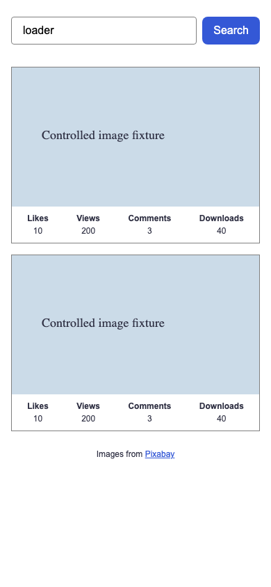
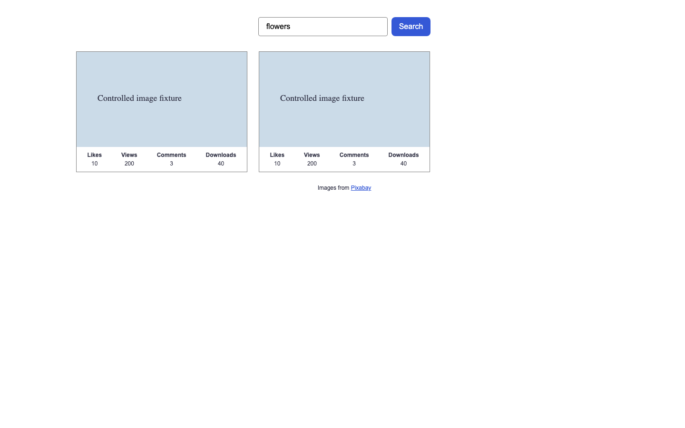
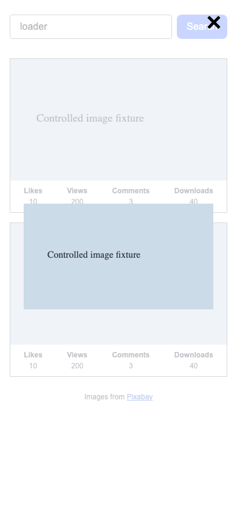
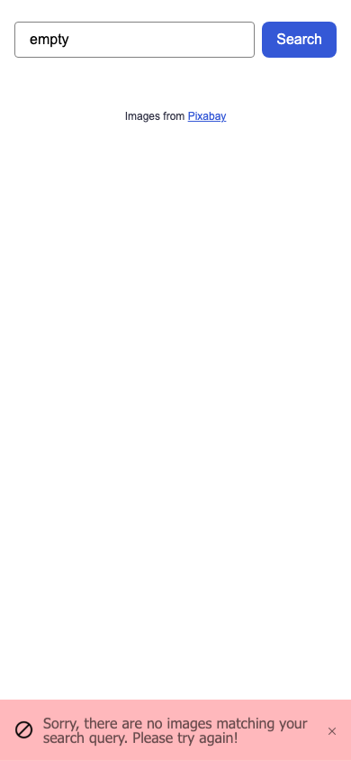
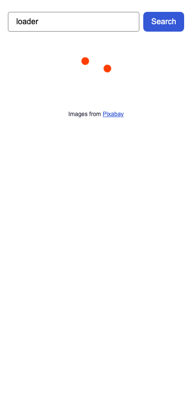
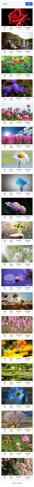
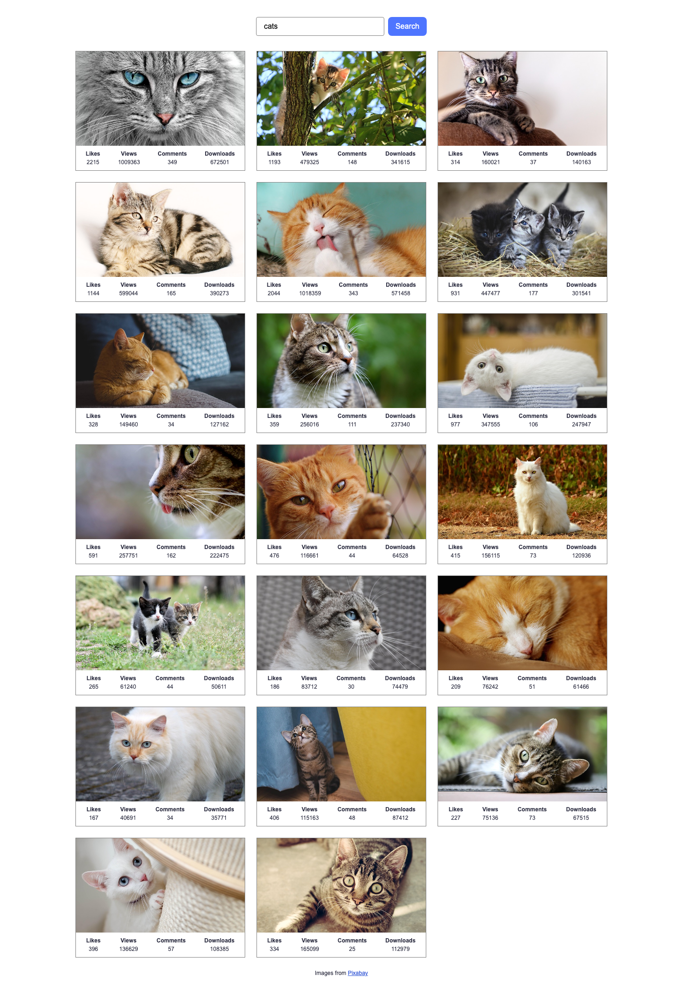
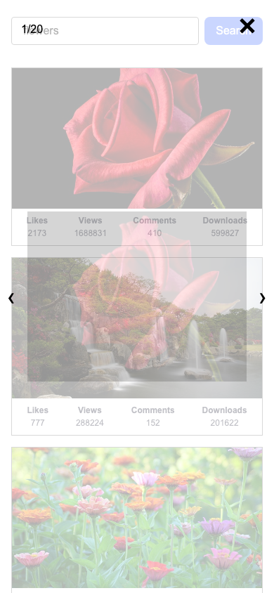

# ДЗ 3 — Пошук зображень: як це працює

## Що ми створили

Це сторінка пошуку фотографій. Ти вводиш слово, натискаєш Search і бачиш картки. Натискання на фото відкриває більшу версію.

Це навчальний браузерний застосунок. Власного бекенду немає: готові дані повертає Pixabay.

**Схема роботи, не доказ запуску:** ввела слово → Axios → Pixabay → відповідь → галерея.

## Карта файлів

```text
goit-advancedjs-hw-03/
├── .editorconfig
├── assets/
├── .env.example
├── package.json
├── package-lock.json
├── vite.config.js
├── .github/workflows/deploy.yml
└── src/
    ├── index.html
    ├── main.js
    ├── img/
    ├── css/
    │   ├── styles.css
    │   └── loader.css
    └── js/
        ├── pixabay-api.js
        └── render-functions.js
```

`index.html` створює порожню сторінку: форму, лоадер і список. `main.js` керує пошуком. `pixabay-api.js` спілкується з API. `render-functions.js` змінює те, що видно на екрані.

`styles.css` задає вигляд. `loader.css` містить готову CSS-анімацію з vineethtrv/css-loader. `package.json` описує залежності й команди. `package-lock.json` фіксує встановлені версії. Vite запускає сторінку локально та збирає файли для публікації.

## Запуск із нуля

1. Встанови Node.js 22.
2. Відкрий термінал у папці проєкту.
3. Встанови залежності:

```sh
npm ci
```

4. Створи локальний файл налаштувань:

```sh
cp .env.example .env
```

5. Відкрий `.env` у редакторі.
6. Запиши власний ключ після `VITE_PIXABAY_API_KEY=`. Отримати його можна у своєму акаунті: https://pixabay.com/api/docs/.
7. Запусти сервер:

```sh
npm run dev
```

8. Відкрий адресу, яку покаже Vite.

Після зміни `.env` перезапусти Vite. Не надсилай ключ у чат і не додавай `.env` у Git.

**Ключ не стає секретним у браузері.** Vite вставляє значення `VITE_` у код сайту. Його можна побачити у збірці й мережевому запиті. GitHub Actions secret також не приховує ключ у готовій сторінці.

## Крок 1. Читаємо слово

Що робимо: слухаємо відправлення форми й прибираємо зайві пробіли.

```js
form.addEventListener('submit', event => {
  event.preventDefault();
  const query = form.elements['search-text'].value.trim();
```

`submit` — подія відправлення форми. `preventDefault()` зупиняє стандартне перезавантаження сторінки. `trim()` прибирає пробіли на початку й наприкінці.

На екрані: після Search сторінка залишається відкритою. Порожнє поле зупиняє HTML-атрибут `required`. Самі пробіли зупиняє перевірка `if (!query)` у `main.js`; iziToast показує повідомлення.

## Крок 2. Готуємо новий пошук

```js
const searchId = ++latestSearch;
iziToast.destroy();
clearGallery();
showLoader();
```

Кожен пошук отримує номер. Старі повідомлення й картки прибираємо. Показуємо лоадер перед запитом.

На екрані: старі фото зникають; поки відповідь не прийшла, видно анімацію.

## Крок 3. Надсилаємо HTTP-запит

HTTP-запит — звернення браузера до сервера. Axios робить GET-запит, тобто просить прочитати дані.

```js
return axios
  .get('https://pixabay.com/api/', {
    params: {
      key,
      q: query,
      image_type: 'photo',
      orientation: 'horizontal',
      safesearch: true,
    },
    timeout: 15000,
  })
  .then((response) => response.data);
```

`q` містить твоє слово. Інші параметри залишають фото горизонтального формату та вмикають фільтр безпечного вмісту. Axios кодує параметри URL. `timeout` обмежує очікування до 15 секунд.

`response` — вся відповідь Axios. `response.data` — тіло відповіді сервера. Саме його повертає `getImagesByQuery(query)`.

Якщо ключ не налаштований, функція повертає відхилений Promise без запиту до Pixabay. На екрані з'являється інструкція про `.env`.

## Крок 4. Розбираємо відповідь

Promise — об'єкт майбутнього результату. Зараз даних ще немає; пізніше операція завершиться успіхом або помилкою.

```js
getImagesByQuery(query).then(({ hits }) => {
  if (searchId !== latestSearch) return;
  if (hits.length === 0) {
    iziToast.error({
      message:
        'Sorry, there are no images matching your search query. Please try again!',
    });
    return;
  }
  createGallery(hits);
});
```

`then()` запускає код після успіху. `hits` — масив знайдених зображень. `{ hits }` дістає цю властивість з об'єкта відповіді.

Перевірка номера пропускає стару відповідь. Наприклад, ти шукала cats, потім flowers. Навіть якщо cats прийде пізніше, він не замінить flowers.

На екрані: або нові картки, або точне повідомлення про відсутність результатів. Перевірка `hits.length` залишається у `main.js`.

## Крок 5. Створюємо картки

```js
const markup = images.map(/* створення картки */).join('');
gallery.insertAdjacentHTML('beforeend', markup);
lightbox.refresh();
```

Перший рядок тут скорочено для пояснення; повний шаблон є у `render-functions.js`. `map()` створює HTML для кожного фото. `join('')` об'єднує всі картки в один рядок. `insertAdjacentHTML()` додає всю розмітку за одну DOM-операцію.

DOM — представлення HTML-елементів, яке браузер може змінювати. `refresh()` повідомляє SimpleLightbox, що у списку з'явилися нові посилання.

Картка використовує `webformatURL` для маленького фото, `largeImageURL` для посилання, `tags` для опису `alt`. Унизу показуємо Likes, Views, Comments і Downloads.

`escapeHtml()` перетворює спеціальні символи тексту й атрибутів на безпечні HTML-сутності. `imageUrl()` дозволяє лише HTTPS. Так дані відповіді не перетворяться на сторонню розмітку чи небезпечне посилання. Помилковий URL переходить у `catch()`.

## Крок 6. Обробляємо помилку й завершуємо очікування

```js
.catch(error => {
  if (searchId !== latestSearch) return;
  iziToast.error({ message: /* повідомлення залежить від помилки */ });
})
.finally(() => {
  if (searchId === latestSearch) hideLoader();
});
```

Фрагмент скорочено лише в місці вибору тексту. Повний текст є у `main.js`.

`catch()` обробляє відхилений Promise: мережеву помилку, HTTP-помилку або помилку створення картки. Не показуємо користувачу сирий текст сервера чи ключ.

`finally()` виконується після успіху або помилки. Лоадер ховає лише останній пошук. Старий запит не може прибрати індикатор нового.

## Export та import

```js
export function getImagesByQuery(query) {
  /* повний код у файлі */
}
import { getImagesByQuery } from './js/pixabay-api.js';
```

`export` дозволяє іншим файлам використовувати функцію. `import` підключає її. Так запит, відображення і керування формою не змішані в одному файлі.

## Для чого бібліотеки

- Axios надсилає HTTP-запит і повертає Promise.
- iziToast показує короткі повідомлення про помилки та порожній ввід.
- SimpleLightbox відкриває велике фото поверх сторінки; у нас один екземпляр.
- vineethtrv/css-loader дає CSS-анімацію очікування. Це не webpack-пакет `css-loader`.

## Як змінити самій

1. Для кольору кнопки відкрий `src/css/styles.css` і знайди `button`.
2. Для розміру фото зміни `.gallery img`.
3. Для нової інформації картки зміни шаблон у `createGallery()`; використовуй тільки наявні поля API та `escapeHtml()`.
4. Для повідомлення відкрий `src/main.js` і зміни потрібний `message`.
5. Точне повідомлення про порожні результати залиш без змін: воно потрібне за ТЗ.
6. Після змін виконай форматування й збірку:

```sh
npm run format
npm run format:check
npm run build
npm run preview
```

## Перевірки й докази

Браузерні результати записані у `output/playwright/results.json`. Скриншоти з цієї папки показують справжню локальну сторінку, але API-відповіді та зображення контрольовані. Це не доказ реального пошуку Pixabay.

Реальний пошук перевірено з твоїм ключем: flowers повернув 20 фото, cats замінив попередні результати, запит без збігів дав потрібне повідомлення. Фото завантажилися, lightbox відкрився, лоадер сховався. У консолі не було помилок, попереджень і логів. Результат: `output/playwright/live-results.json`. GitHub Pages опубліковано. Ті самі перевірки реального API пройшли на публічному сайті. Структуру папок оновлено за наданим скриншотом. Порожні `assets` і `src/img` містять `.gitkeep`, щоб Git зберіг папки. Figma не надано; точну візуальну відповідність ще не перевірено.

Під час підготовки старий шлях CSS-лоадера повернув 404. Знайдено актуальний `src/loaders/bubble/bubble01.module.css`; файл і MIT-ліцензію додано локально. Початковий браузерний запуск виявив `global is not defined`: SimpleLightbox звертається до `global`. У `vite.config.js` додано `define: { global: {} }`, як у попередній домашці. Повторний запуск пройшов. На мобільному повідомлення iziToast перекривало Search; `position` змінено на `bottomRight`, повторні пошуки пройшли. Встановлення залежностей у зовнішньому процесі використало Node 21 і дало попередження Vite; локальна збірка працює на Node 22.

Перед публікацією потрібно врахувати правила Pixabay: https://pixabay.com/api/docs/. Документація має приклад JavaScript у браузері, але також вимагає кешувати запити 24 години. У `pixabay-api.js` додано кеш на 24 години: повторне слово повертає збережену відповідь без нового HTTP-запиту. Кеш містить дані фото, не API-ключ. Якщо `localStorage` заблоковано, використовуємо кеш у пам'яті до закриття сторінки.

### Скриншоти локального запуску

Усі кадри нижче використовують контрольовані API-відповіді й тестові зображення.











## Здача

Локальна папка: `homework/goit-advancedjs-hw-03`. ZIP: `homework/goit-advancedjs-hw-03.zip`.

Код: https://github.com/diagnosel/goit-advancedjs-hw-03

Сайт: https://diagnosel.github.io/goit-advancedjs-hw-03/ Самостійно до LMS нічого не відправляємо.

## Самоперевірка

<details><summary>1. Що повертає getImagesByQuery()?</summary>
Promise, який після успіху дає response.data — тіло відповіді Pixabay.
</details>

<details><summary>2. Чому trim() потрібен, якщо є required?</summary>
required зупиняє порожнє поле. trim() допомагає зупинити поле, яке містить лише пробіли.
</details>

<details><summary>3. Що таке hits?</summary>
Масив об'єктів знайдених зображень у відповіді API.
</details>

<details><summary>4. Навіщо refresh()?</summary>
Щоб SimpleLightbox підключив нові посилання галереї після зміни DOM.
</details>

<details><summary>5. Чому finally() перевіряє номер пошуку?</summary>
Щоб старий запит не сховав лоадер нового пошуку.
</details>

## Реальний Pixabay: скриншоти

Ці кадри показують реальні відповіді Pixabay.






